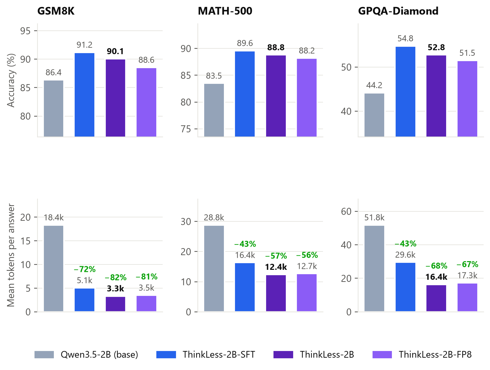

# ThinkLess: teaching a 2B reasoning model to think less and answer better

Small reasoning models over-think: Qwen3.5-2B spends ~18k tokens on an average GSM8K problem and still runs out of
budget on 8% of them. **ThinkLess-2B** is Qwen3.5-2B post-trained with **SFT on its own shortest correct solutions**
and a short **GRPO run with an accuracy-and-length reward**. It uses **57–82% fewer reasoning tokens** and is
**more accurate** on GSM8K, MATH-500 and GPQA-Diamond. Served with vLLM and MTP speculative decoding, a typical request
finishes **3.4× faster**.

**Models and data on Hugging Face:** [ThinkLess-2B](https://huggingface.co/Shaik1903/ThinkLess-2B) ·
[ThinkLess-2B-SFT](https://huggingface.co/Shaik1903/ThinkLess-2B-SFT) ·
[ThinkLess-2B-FP8](https://huggingface.co/Shaik1903/ThinkLess-2B-FP8) ·
[ThinkLess-data](https://huggingface.co/datasets/Shaik1903/ThinkLess-data) ·
[collection](https://huggingface.co/collections/Shaik1903/thinkless-6abd518a743623d7dc876abf)



## Results

All accuracies at Qwen's recommended 81,920-token thinking budget; changes are paired over the same problems with 95%
bootstrap intervals.

| | Qwen3.5-2B (base) | **ThinkLess-2B** | Change |
|---|---|---|---|
| GSM8K accuracy | 86.4 | **90.1** | **+3.7** [+1.7, +5.7] |
| MATH-500 accuracy | 83.5 | **88.8** | **+5.3** [+2.8, +7.8] |
| GPQA-Diamond accuracy | 44.2 | **52.8** | **+8.6** [+3.3, +13.9] |
| Mean tokens, GSM8K | 18,351 | **3,341** | **−82%** |
| Mean tokens, MATH-500 | 28,824 | **12,412** | **−57%** |
| Mean tokens, GPQA-Diamond | 51,826 | **16,370** | **−68%** |
| Answers cut off at the limit, MATH-500 | 14.4% | **0.7%** | |
| Median request latency (vLLM, H100) | 20.0 s | **5.8 s** (with MTP) | **3.4× faster** |

- **FP8 is near-lossless** (GSM8K 88.6, MATH-500 88.2, GPQA 51.5; 2.5 GB vs 4.3 GB). **4-bit AWQ is not**: it lost
  7–15 points and brought the loops back, so it was not released.
- **Limitation:** on olympiad problems (HMMT Feb 2025) the SFT model matches the base (19.2 vs 18.8) but ThinkLess-2B
  trades accuracy for shorter answers (12.9). Use ThinkLess-2B-SFT for competition math.

Details, budget-forcing curves, serving numbers and worked examples are in the
[model card](release/ThinkLess-2B/README.md).

## How it works

1. **Decontaminate** (`check_overlap.py`): drop training problems with any 13-gram overlap with the eval sets.
2. **Baselines** (`generate.py`, `scripts/sharded.sh`): vLLM sampling at the full 81,920-token budget, thinking on
   and off, sharded over 8 GPUs; graded with `math-verify` (`grading.py`), avg@k with bootstrap CIs (`metrics.py`).
3. **SFT data** (`build_sft_data.py`, `scripts/sft_retry.py`, `scripts/sft_compose.py`): 4 self-samples per problem
   at 8k tokens, 4 more at 16k for unsolved problems, then Qwen3.5-9B for the rest; keep the **shortest correct and
   finished** solution per problem; cap GSM8K so easy problems don't dominate. Result: 8,890 examples.
4. **SFT** (`train_sft.py`): full fine-tune, 2 epochs, lr 1e-5, 8×H100 in 41 minutes.
5. **GRPO** (`train_grpo.py`, `reward.py`): TRL 1.14 with colocated vLLM; reward `0` if wrong or unfinished, else
   `1 − 0.5·min(len, 12288)/12288`, so a short wrong answer never beats a long correct one. `grpo_budget.py` picks the
   length cap from the SFT model's answer lengths.
6. **Select** (`select_checkpoint.py`): choose the checkpoint on a held-out MATH validation set, never on the reported
   benchmarks.
7. **Compress and serve** (`quantize.py`, `bench.py`, `scripts/serve_bench.sh`): FP8 and AWQ, accuracy re-checked,
   then a vLLM load test with natural stopping, with and without MTP speculative decoding.

`scripts/pipeline.sh` runs all of it unattended on one 8×H100 VM: resumable stages, one retry each, quality gates
(`check_gates.py`) that halt the run and shut the VM down if a stage fails twice.

## What went wrong in GRPO (and what fixed it)

1. **No learning for 37 steps.** TRL's default vLLM importance-sampling mode (`sequence_mask`) multiplies per-token
   ratios over the whole answer; at 8–12k tokens every answer was masked and the gradient was ~1e-9.
   **Fix:** `vllm_importance_sampling_mode="token_truncate"` plus a guard that fails the run if the gradient norm stays
   near zero.
2. **Collapse after ~15 steps.** Sampling with Qwen's *inference* settings (presence penalty, top-k, top-p) made the
   training samples off-policy; with no KL anchor the model drifted into word salad. Plain sampling cut the
   vLLM/trainer log-prob gap from 0.09 to 0.013; a KL-anchored retry ran out of memory at 12k tokens, so the last healthy
   checkpoint (step 10) was shipped: +8.5 points over SFT on the validation set.
3. **Problems that were too hard.** On DAPO-Math-17k only 13% of answers finished within 12k tokens, so most GRPO groups
   had no signal. **Fix:** train on MATH levels 3–5.

## Repository layout

| Path | What |
|---|---|
| `*.py` | data, generation, grading, metrics, reward, SFT/GRPO training, checkpoint selection, quantization, serving benchmark, plots |
| `scripts/pipeline.sh` | the end-to-end run (stages, gates, retries, auto-shutdown) |
| `scripts/create_vm.sh`, `setup_env.sh` | GCP VM creation and environment setup |
| `scripts/sharded.sh`, `serve_bench.sh` | multi-GPU generation and the vLLM serving benchmark |
| `tests/` | unit tests (`pytest`) |
| `release/` | model cards, charts, examples, upload script and run results |

## Reproduce

Hardware used: one 8×H100 (GCP `a3-highgpu-8g`, flex-start) for ~11 hours plus an L4 for development.
Total cost of the real run: **$559**. Software: vLLM 0.30.0, TRL 1.14.1, Transformers 5.17.0, PyTorch 2.13 (CUDA 13).

```bash
# HF_TOKEN and WANDB_API_KEY go in .env (git-ignored); create a GCS bucket first
export BUCKET=your-bucket-name
bash scripts/create_vm.sh thinkless-run h100x8 12h      # prints the zone it got
# on the VM, with the repo at ~/thinkless:
bash scripts/setup_env.sh
bash scripts/pipeline.sh                                # resumable; logs in logs/, results in results/
```

Tests (CPU only): `pip install math-verify pytest && pytest -q`.

## License

Code: Apache-2.0 (same as the base model). Built on [Qwen3.5-2B](https://huggingface.co/Qwen/Qwen3.5-2B) by the Qwen
team. Evaluation sets: GSM8K, MATH-500, GPQA-Diamond, HMMT Feb 2025 (GPQA and HMMT rows are not redistributed).
