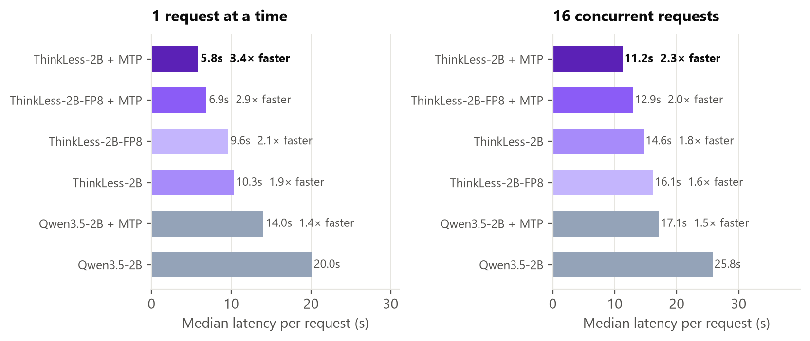
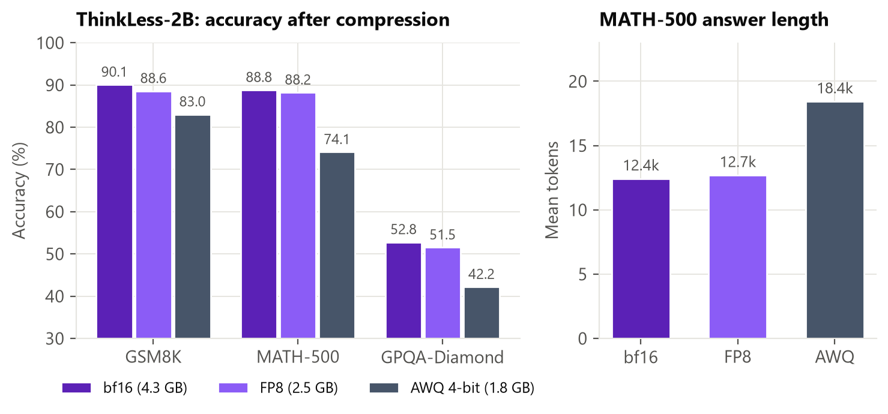

# ThinkLess-2B-FP8

**FP8 version of [ThinkLess-2B](https://huggingface.co/Shaik1903/ThinkLess-2B)**: 8-bit floating-point weights and
activations, **2.5 GB** (bf16: 4.3 GB), with near-identical accuracy. Made with
[llm-compressor](https://github.com/vllm-project/llm-compressor) (`FP8_DYNAMIC`: per-channel FP8 weights, dynamic
per-token FP8 activations, no calibration data). The output head, vision tower and MTP heads stay in 16-bit.

## Accuracy (81,920-token budget, thinking on)

| Benchmark | ThinkLess-2B (bf16) | **ThinkLess-2B-FP8** | Mean tokens: bf16 → FP8 |
|---|---|---|---|
| GSM8K | 90.1 | **88.6** | 3,341 → 3,512 |
| MATH-500 | 88.8 | **88.2** | 12,412 → 12,680 |
| GPQA-Diamond | 52.8 | **51.5** | 16,370 → 17,270 |

The differences are within the 95% confidence intervals, and answers stay just as short (cut-offs ≤ 1%).

## Serving (vLLM 0.30, one H100, max 8,192 output tokens)



| Configuration | Concurrency 1: tokens/s | Concurrency 1: median latency | Concurrency 16: requests/s | MTP acceptance |
|---|---|---|---|---|
| Qwen3.5-2B (base) | 400 | 20.0 s | 0.66 | – |
| ThinkLess-2B (bf16) | 396 | 10.3 s | 0.83 | – |
| **ThinkLess-2B-FP8** | **440** | 9.6 s | **0.88** | – |
| **ThinkLess-2B-FP8 + MTP** | **557** | **6.9 s** | **0.99** | 54% |

## How to use

```bash
vllm serve Shaik1903/ThinkLess-2B-FP8 --speculative-config '{"method":"mtp","num_speculative_tokens":2}'
```

FP8 compute needs a GPU with FP8 support (NVIDIA Hopper or Ada, e.g. H100, L4, RTX 40-series); vLLM loads the
`compressed-tensors` format directly. Use Qwen3.5's thinking-mode sampling (temperature 1.0, top-p 0.95, top-k 20,
presence penalty 1.5).

## Why FP8 rather than 4-bit

A 4-bit AWQ version of ThinkLess-2B was also evaluated: it lost 7–15 points (MATH-500 88.8 → 74.1), made answers
*longer* and was slower than bf16 on an H100. Small reasoning models are sensitive to low-bit weights over long
reasoning chains; FP8 keeps the accuracy.



Training details, evaluation protocol and limitations: [ThinkLess-2B](https://huggingface.co/Shaik1903/ThinkLess-2B).
