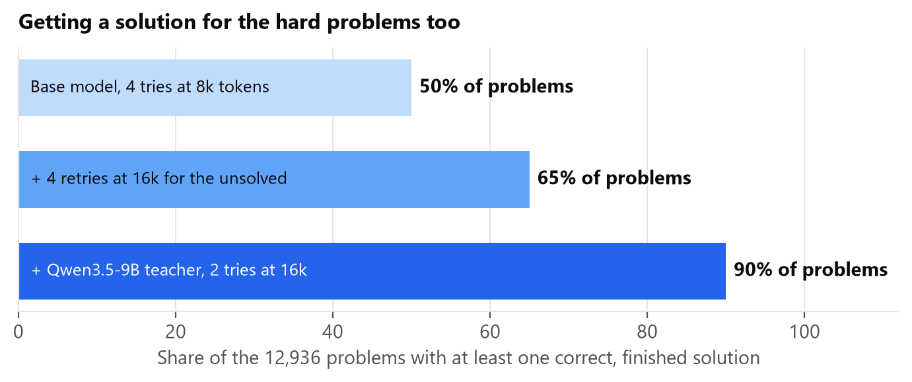
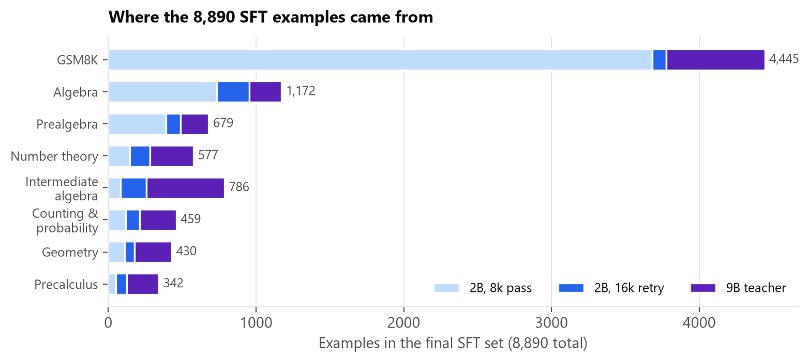

# ThinkLess-2B-SFT

The **SFT stage** of [ThinkLess-2B](https://huggingface.co/Shaik1903/ThinkLess-2B): Qwen3.5-2B fine-tuned on its own
**shortest correct solutions** (with a same-family 9B teacher filling in the hardest problems). It is the most
accurate model in the ThinkLess family and cuts reasoning length by **43–72%** vs the base model.

**Use this model** when you want the highest accuracy, including competition-level math (on HMMT Feb 2025 it matches
the base model, 19.2 vs 18.8). **Use [ThinkLess-2B](https://huggingface.co/Shaik1903/ThinkLess-2B)** when you want
the shortest reasoning at near-identical accuracy on everyday math and science.

## Results (81,920-token budget, thinking on)

| Benchmark | Qwen3.5-2B (base) | **ThinkLess-2B-SFT** | Change (paired, 95% CI) | Mean tokens: base → SFT |
|---|---|---|---|---|
| GSM8K | 86.4 | **91.2** | **+4.9** [+3.2, +6.7] | 18,351 → **5,078** (−72%) |
| MATH-500 | 83.5 | **89.6** | **+6.1** [+3.6, +8.7] | 28,824 → **16,351** (−43%) |
| GPQA-Diamond | 44.2 | **54.8** | **+10.6** [+5.6, +15.9] | 51,826 → **29,590** (−43%) |

Answers cut off at the limit: GSM8K 8.1% → 0.5%, MATH-500 14.4% → 3.0%, GPQA 31.1% → 7.1%.

**Under a hard thinking budget** (thinking stopped at B tokens, then the model must answer), ThinkLess-2B-SFT is the
best model at tight limits: GSM8K 75.1 / 82.1 / 88.1 / 89.0 and MATH-500 46.4 / 50.8 / 60.2 / 72.7 at
2k / 4k / 8k / 16k tokens (base: 64.9 / 68.0 / 71.9 / 78.0 and 40.6 / 40.5 / 47.8 / 58.1).

## Training





- **Data:** 8,890 problems from GSM8K train and MATH train (levels 3–5), 13-gram decontaminated against the evaluation
  sets. For each problem, the **shortest correct and finished** solution among: 4 base-model samples at an 8k cap,
  4 more at 16k for problems still unsolved, and 2 from Qwen3.5-9B for the rest (59.8% / 10.8% / 29.4% of the data).
  GSM8K was capped at the number of MATH examples, keeping its shortest solutions. Released in
  [ThinkLess-data](https://huggingface.co/datasets/Shaik1903/ThinkLess-data) (config `sft`).
- **Recipe:** full fine-tune, 2 epochs (140 steps), lr 1e-5 cosine, effective batch 128, max length 17,408 tokens,
  fp32 master weights with bf16 autocast, 8×H100 (41 min). Loss 0.437 → 0.381.

Full details, evaluation protocol and limitations: [ThinkLess-2B](https://huggingface.co/Shaik1903/ThinkLess-2B).

## How to use

```bash
vllm serve Shaik1903/ThinkLess-2B-SFT --speculative-config '{"method":"mtp","num_speculative_tokens":2}'
```

Use Qwen3.5's thinking-mode sampling (temperature 1.0, top-p 0.95, top-k 20, presence penalty 1.5).
