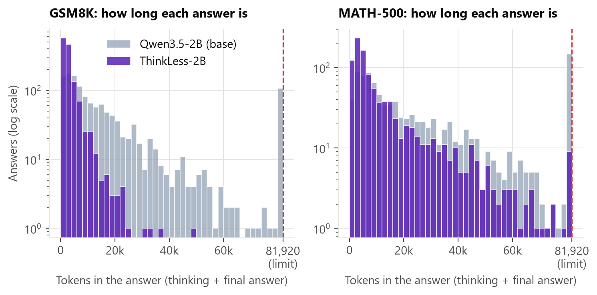
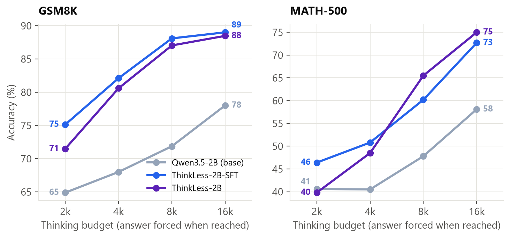
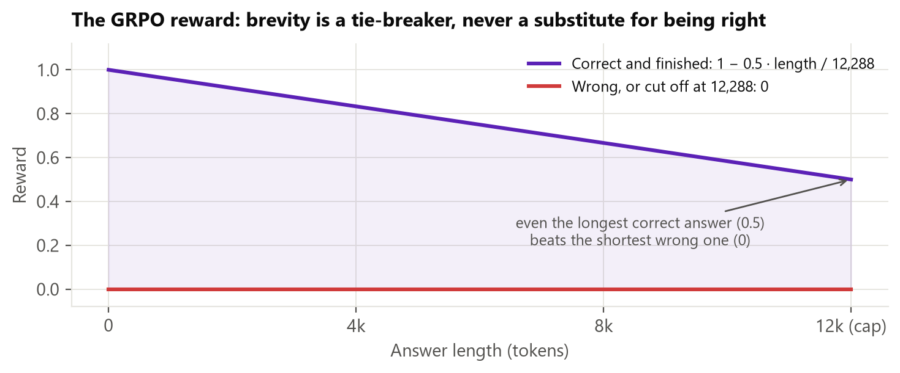

# ThinkLess-2B

**Qwen3.5-2B that thinks less and answers better.** ThinkLess-2B uses **57–82% fewer reasoning tokens** than the
base model on math and science benchmarks while being **more accurate** on GSM8K, MATH-500 and GPQA-Diamond, with
almost no answers cut off mid-thought. Served with vLLM and its built-in MTP speculative decoding, a typical request
finishes **3.4× faster** than the base model.

It was post-trained in two stages: **SFT on the model's own shortest correct solutions** (self-distillation, with a
same-family 9B teacher filling in the hardest problems), then **a short GRPO run with an accuracy-and-length reward**.


## Highlights

| | Qwen3.5-2B (base) | **ThinkLess-2B** | Change (paired, 95% CI) |
|---|---|---|---|
| GSM8K accuracy | 86.4 | **90.1** | **+3.7** [+1.7, +5.7] |
| MATH-500 accuracy | 83.5 | **88.8** | **+5.3** [+2.8, +7.8] |
| GPQA-Diamond accuracy | 44.2 | **52.8** | **+8.6** [+3.3, +13.9] |
| Mean tokens, GSM8K | 18,351 | **3,341** | **−82%** |
| Mean tokens, MATH-500 | 28,824 | **12,412** | **−57%** |
| Mean tokens, GPQA-Diamond | 51,826 | **16,370** | **−68%** |
| Answers cut off at the limit, MATH-500 | 14.4% | **0.7%** | |
| Median request latency (vLLM, H100) | 20.0 s | **5.8 s** (with MTP) | **3.4× faster** |

All accuracies are at Qwen's recommended **81,920-token** thinking budget; see [Evaluation](#evaluation).

## Model family

| Model | What it is | Use it when |
|---|---|---|
| **ThinkLess-2B** (this repo) | SFT + 10 GRPO steps | You want the shortest reasoning at near-SFT accuracy |
| [ThinkLess-2B-SFT](https://huggingface.co/Shaik1903/ThinkLess-2B-SFT) | SFT only | You want the highest accuracy, including olympiad-level problems |
| [ThinkLess-2B-FP8](https://huggingface.co/Shaik1903/ThinkLess-2B-FP8) | FP8 weights + activations of ThinkLess-2B | Half the memory at near-identical accuracy (GSM8K 88.6, MATH-500 88.2, GPQA 51.5) |

| Benchmark (82k budget) | ThinkLess-2B (bf16) | ThinkLess-2B-FP8 |
|---|---|---|
| GSM8K | 90.1 | 88.6 |
| MATH-500 | 88.8 | 88.2 |
| GPQA-Diamond | 52.8 | 51.5 |
| Size on disk | 4.3 GB | **2.5 GB** |

## Results

### Accuracy at the full budget (81,920 tokens)

Mean accuracy over k samples per problem (avg@k), with 95% bootstrap confidence intervals over problems.

| Benchmark (samples per problem) | Base | SFT | **ThinkLess** |
|---|---|---|---|
| GSM8K (1,319 × 1) | 86.4 [84.4–88.0] | 91.2 [89.6–92.7] | **90.1** [88.4–91.5] |
| MATH-500 (500 × 2) | 83.5 [80.4–86.2] | 89.6 [86.9–91.8] | **88.8** [86.4–91.1] |
| GPQA-Diamond (198 × 2) | 44.2 [38.6–49.7] | 54.8 [49.0–60.9] | **52.8** [47.0–58.6] |

Compared on the same problems, ThinkLess-2B is within noise of ThinkLess-2B-SFT on all three benchmarks (paired 95%
intervals include 0) while using 24–45% fewer tokens.

### Reasoning length and cut-offs

| Benchmark | Mean tokens: Base → SFT → ThinkLess | Cut off at 81,920: Base → SFT → ThinkLess |
|---|---|---|
| GSM8K | 18,351 → 5,078 → **3,341** | 8.1% → 0.5% → **0.0%** |
| MATH-500 | 28,824 → 16,351 → **12,412** | 14.4% → 3.0% → **0.7%** |
| GPQA-Diamond | 51,826 → 29,590 → **16,370** | 31.1% → 7.1% → **0.5%** |

The base model's long answers are mostly **loops**: it re-verifies the same steps until it runs out of budget.
ThinkLess keeps the reasoning and drops the loops.



### Accuracy within a token budget

Share of problems answered correctly *and* finished within B tokens (from the same runs, no intervention):

| Benchmark | Budget | Base | SFT | **ThinkLess** |
|---|---|---|---|---|
| GSM8K | 4k | 25.2 | 65.4 | **76.0** |
| GSM8K | 8k | 46.4 | 82.4 | **86.8** |
| MATH-500 | 4k | 13.3 | 29.2 | **36.8** |
| MATH-500 | 8k | 29.5 | 51.0 | **59.7** |
| MATH-500 | 16k | 47.9 | 70.0 | **75.1** |
| GPQA-Diamond | 8k | 0.0 | 7.6 | **17.2** |
| GPQA-Diamond | 16k | 4.8 | 23.0 | **37.9** |

### Budget forcing (hard thinking limit)



Qwen's thinking-budget recipe: thinking is stopped at B tokens, the model is told *"Considering the limited time, I
have to give the solution based on the thinking directly now."*, and it answers (up to 1,024 more tokens). Every
question gets an answer at every budget.

| Budget | GSM8K: Base | SFT | **ThinkLess** | MATH-500: Base | SFT | **ThinkLess** |
|---|---|---|---|---|---|---|
| 2k | 64.9 | **75.1** | 71.5 | 40.6 | **46.4** | 39.8 |
| 4k | 68.0 | **82.1** | 80.6 | 40.5 | **50.8** | 48.5 |
| 8k | 71.9 | **88.1** | 87.0 | 47.8 | 60.2 | **65.5** |
| 16k | 78.0 | **89.0** | 88.5 | 58.1 | 72.7 | **75.0** |

Under a hard thinking limit, both ThinkLess models beat the base model by up to 17 points. ThinkLess-2B is best on
MATH-500 at 8k–16k (the range GRPO trained in, with a 12k cap), while ThinkLess-2B-SFT is best under very tight
limits (2k–4k). ThinkLess also uses the fewest tokens at every budget (GSM8K at a 16k limit: base 9,740, SFT 4,233,
ThinkLess 3,256).

### Serving (vLLM 0.30, one H100, max 8,192 output tokens)


| Configuration | Concurrency 1: tokens/s | Concurrency 1: median latency | Concurrency 16: requests/s | MTP acceptance |
|---|---|---|---|---|
| Base | 400 | 20.0 s | 0.66 | – |
| Base + MTP | 572 | 14.0 s | 0.87 | 66% |
| ThinkLess | 396 | 10.3 s | 0.83 | – |
| **ThinkLess + MTP** | **545** | **5.8 s** | **1.00** | 55% |
| ThinkLess-FP8 | 440 | 9.6 s | 0.88 | – |
| ThinkLess-FP8 + MTP | 557 | 6.9 s | 0.99 | 54% |

ThinkLess's gain is in **requests**, not tokens per second: each answer is shorter. MTP (Qwen3.5's built-in
multi-token-prediction head) then makes each token faster; the two multiply. The 8,192-token cap in this benchmark
*understates* the gap, since the base model's real answers average 18k–52k tokens.

## Examples

Same question, same sampling settings, 81,920-token budget. The base model's outputs are too long to print, so each example shows the comparison, ThinkLess's full answer, and base excerpts; the full outputs of both models are in [`examples/`](examples/).

### Example 1. GSM8K: same answer, 52x fewer tokens

**Question:** John and Jack have 30 minutes to walk to school together. It takes them 6 minutes to get to the corner where the library is. It takes them another 13 minutes to get to the fire station. How much longer do they have to get to school without being late?

| | Qwen3.5-2B (base) | **ThinkLess-2B** |
|---|---|---|
| Tokens | 45,437 | **870** (52x fewer) |
| Answer | 11 (correct) | **11 (correct)** |
| "Wait" in the reasoning | 249 | 0 |

**What happened:** The base model worked out 30 − 19 = 11 within its first ~1,100 tokens (*"Is that it? It seems too simple."*), then second-guessed the wording for another 44,000 tokens and 249 *"Wait"*s before answering 11. ThinkLess solves it once and stops.

<details><summary><b>ThinkLess-2B: full output (870 tokens)</b></summary>

```text
Here's a thinking process that leads to the solution:

1.  **Analyze the Request:**
    *   **Time Limit:** 30 minutes total available for both John and Jack to walk together to school.
    *   **Segment 1 (Corner):** Takes 6 minutes.
    *   **Segment 2 (Fire Station):** Takes another 13 minutes.
    *   **Goal:** Calculate how much longer time they have before running late or exceeding the limit.
    *   **Format:** Step-by-step reasoning followed by the final answer in a box.

2.  **Calculate Total Walking Time:**
    *   I need to add up all the durations mentioned so far until reaching school.
    *   Segment 1 Duration = $6$ minutes.
    *   Segment 2 Duration = $13$ minutes.
    *   Sum of known times = $6 + 13$.
    *   Calculation: $6 + 13 = 19$.

3.  **Determine Remaining Time:**
    *   The problem asks "How much longer do they have to get to school...". This implies calculating the difference between their current accumulated time and the total allowed time.
    *   Total Allowed Time = 30 minutes.
    *   Current Accumulated Time = 19 minutes.
    *   Difference = Allowed - Current.
    *   Calculation: $30 - 19$.

4.  **Perform Subtraction:**
    *   $30 - 10 = 20$.
    *   $20 - 9 = 11$.
    *   Result: 11.

5.  **Verify Assumptions/Logic Check:**
    *   Does it say they travel separately? No, "walk... together" suggests walking from start point to destination sequentially or simultaneously along the route described.
    *   Usually, word problems like this imply sequential travel unless stated otherwise ("It takes them X to A and B"). Since no specific speed/distance data is given, simple arithmetic summation is the standard approach.
    *   Is there any trick regarding simultaneous walking vs. one after another? Without knowing speeds, I must assume linear progression based on the text "get to the corner... then get to the fire station". If they were walking at different rates, it wouldn't matter for the *duration* count provided. The prompt gives absolute time durations for the segments. So, simply adding these is correct.

6.  **Drafting the Response:**
    *   State the total time required for each leg of the journey ($6$ min + $13$ min).
    *   State the total limit provided ($30$ min).
    *   Perform the subtraction to find the remaining capacity.
    *   Format output as requested.

7.  **Final Polish:**
    *   Current Time Taken: $6 + 13 = 19$ minutes.
    *   Total Available Time: $30$ minutes.
    *   Difference: $30 - 19 = 11$ minutes.
    *   Answer: 11 minutes.

8.  **Output Generation** (Proceed to generate response matching steps).
</think>

To determine how much longer they have to get to school, we first calculate the total amount of time spent traveling so far.

1.  **Travel Time:** They spend 6 minutes getting to the corner and 13 minutes getting to the fire station.
    $$6 \text{ minutes} + 13 \text{ minutes} = 19 \text{ minutes used so far.}$$

2.  **Total Available Time:** The deadline is 30 minutes.

3.  **Remaining Time:** Subtract the time already spent from the total limit.
    $$30 \text{ minutes (limit)} - 19 \text{ minutes (used)} = 11 \text{ minutes.}$$

They have 11 minutes left.

\boxed{11}
```

</details>

<details><summary><b>Qwen3.5-2B (base): excerpts from 45,437 tokens</b></summary>

```text
Here's a thinking process that leads to the solution:

1.  **Analyze the Problem:**
    *   **Goal:** Determine how much longer John and Jack have time remaining before getting late for school.
    *   **Starting Point:** They are at some location, presumably where they started walking from? Wait, let's re-read carefully. "John and Jack have 30 minutes to walk to school together." This implies the total time available to complete the *entire* journey is 30 minutes.
    *   **Journey Phases:**
        1.  To the corner where the library is (takes 6 minutes).
        2.  From there to the fire station (takes 13 minutes).
    *   **Missing Information/Assumptions:** Where do they start? Is the path linear? Do they need to walk the distance between the library corner and the school, or is the destination just "school"? The prompt says "without being late". This suggests a deadline constraint.

    Let's break down the logic.
    *   Total Time Available = 30 minutes.
    *   Current status (Time elapsed) = ?
    *   Wait, the phrasing "John and Jack have 30 minutes to walk to school" usually means the *total* duration of the walk is 30 minutes. If the question asks "How much longer do they have to get to school without being late?", it implies a comparison between the required time (or time elapsed) and the limit. Or, it could be a simpler riddle: What time remains in their *schedule* vs what time they *spent*.


[... 65,227 characters omitted ...]

ybe they are *synchronous*.
    Maybe the *library* is the meeting place.
    Maybe they have to meet at the library?
    If they meet at the library.
    Then "How much longer do they have to get to school?"
    If School is after the library.
    Maybe they have to wait for the other?
    
    Let's reconsider the wording "walk to school together".
    This implies a combined effort.
    Maybe they walk to the school *side by side*.
    If one walks *with* the other.
    If "It takes them 6 minutes to get to the corner".
    This might mean they need to walk to the corner.
    If the corner is the *end* of the walk.
    Then School is the Corner.

[... 90,290 characters omitted ...]


However, another interpretation that yields a "trick" answer is if the 30 minutes is the *deadline* and they are *currently* at the start. If the path is short, they might have enough time.
But based on the calculation:
Total time needed = $6 + 13 = 19$.
Total time available = $30$.
Time remaining = $30 - 19 = 11$.

Final Answer: 11 minutes.

\boxed{11}
```

</details>

Full outputs: [base](examples/gsm8k-A1_base.txt) · [ThinkLess](examples/gsm8k-A1_thinkless.txt)

### Example 2. MATH-500: the base model never answers

**Question:** A figure skater is facing north when she begins to spin to her right. She spins 2250 degrees. Which direction (north, south, east or west) is she facing when she finishes her spin?

| | Qwen3.5-2B (base) | **ThinkLess-2B** |
|---|---|---|
| Tokens | 81,920 | **2,331** (35x fewer) |
| Answer | cut off at the limit, **no answer** | **east (correct)** |
| "Wait" in the reasoning | 6,478 | 3 |

**What happened:** The base model sets up the clockwise turns correctly, then falls into a loop of re-checking and finally prints *"Wait."* thousands of times (6,478 in total) until it hits the 81,920-token limit without an answer. ThinkLess reduces 2,250° to 90° past six full turns and answers.

<details><summary><b>ThinkLess-2B: full output (2,331 tokens)</b></summary>

```text
Here's a thinking process that leads to the correct answer:

1.  **Analyze the Problem:**
    *   Initial direction: North.
    *   Action: Spinning to her right (clockwise) for an angle of $2250^\circ$.
    *   Goal: Determine the final facing direction (North, South, East, or West).

2.  **Visualize/Model Direction Changes:**
    *   Imagine a compass rose starting at North ($0^\circ$), moving Counter-Clockwise (CCW) usually in standard math angles, but physical rotation is intuitive here. Let's use degrees relative to North as the starting point.

3.  **Step-by-Step Calculation:**

    *   *Starting Point:* North ($0^\circ$). Note: In physics/math problems involving rotation around the origin without specific vector definitions, let's stick to cardinal directions for clarity first.
        *   North = Up
        *   Right turn means clockwise.
        *   Clockwise increases the angle from North? Or just subtracts the magnitude? Let's trace it physically.

    *   *Rotation Analysis:*
        *   One full circle = $360^\circ$.
        *   We have a total spin of $2250^\circ$.
        *   We need to find the equivalent modulo $360^\circ$ to see where she ends up.

    *   *Calculation:*
        $$ \text{Total Angle} = 2250^\circ $$
        Divide by $360^\circ$:
        $$ 2250 \div 360 = ? $$

        Estimation:
        $360 \times 6 = 2160$.
        So, $2250 - 2160 = 90^\circ$.

        Alternatively:
        $2250 / 360 = 450/60 = 15/2 = 7.5$? Wait.
        $2250 / 360$: Both end in ...0, divisible by 9? No wait. $2+2+5+0=9$, yes div by 9. $3+6+0=9$, yes div by 9.
        $2250/9 = 250$.
        $360/9 = 40$.
        $250 / 40 = 25/4 = 6.25$. Okay, arithmetic error above. Let me re-calculate carefully.

        $2250 / 360$:
        Reduce fraction by dividing top and bottom by 90.
        $2250 / 90 = 25$.
        $360 / 90 = 4$.
        Result: $6.25$ revolutions.

        Now reduce the decimal part:
        $0.25 \text{ revolution} = \frac{1}{4}$ of a circle.
        Since we started rotating Clockwise (right), $\frac{1}{4}$ of a circle clockwise takes us... where do we go?
        
        Visualizing Clockwise movement starting from North (Up):
        - Start at 12 o'clock (North).
        - Rotate right (downwards towards East/West/East?). Clockwise moves: N -> E -> S -> W.
        - $90^\circ$ move right brings you to East.
        - $180^\circ$ move right brings you to South.
        - $270^\circ$ move right brings you to West.
        - $360^\circ$ move right brings you back to North.

    *   *Verification using Modulo Arithmetic:*
        Let North = $0$.
        Rotation is clockwise. In standard polar coordinates measured counter-clockwise from the positive x-axis, North is Y-axis ($90^\circ$). However, simpler logic works best here.

        Total turns = $6$ turns + $0.25$ turns.
        Each full turn restores the original heading.
        Remaining degree change = $0.25 \times 360^\circ$.

        Direction of turn: "To her right". This implies a Clockwise motion.
        Start: North.
        Go Clockwise by $90^\circ$ (quarter turn).
        Facing becomes: East.

        Therefore, after one complete cycle plus $0.25$ cycles (which corresponds to $90^\circ$), she faces East.

    *   *Alternative Interpretation Check (Counter-intuitive check):* Does "spinning to her right" imply changing the axis or something weird? No, standard context implies changing orientation on body axis.

    *   *Wait, is it possible I got the direction wrong mentally?*
        Imagine standing on a map facing North. Turn your head (and body) to the RIGHT. You look toward the East (if walking forward) or simply rotate the map clockwise? Yes. The result stands.

    *   Let's double check the number calculation again.
        $2250 / 360 = 7.5 \dots$ wait no.
        $7 \times 360 = 2520$. Too big.
        $6 \times 360 = 2160$. Remainder = $2250 - 2160 = 90$. Correct.
        So she completes 6 spins. She needs to add another $90$ degrees to face the next cardinal direction based on the direction of spin.

4.  **Synthesizing the Logic Steps:**
    *   Step 1: Identify initial direction (North).
    *   Step 2: Analyze movement type ("spin to her right"). This specifies a clockwise rotation relative to North.
    *   Step 3: Perform division to determine net rotation. $2250^\circ$ divided into circles. $2250 / 360 = 6$ with remainder $90$.
    *   Step 4: Determine effect of remainder on direction. Since the turn was clockwise (Right), moving $90^\circ$ clockwise from North lands directly on East.

    *Self-Correction/Sanity Check:* What if someone thinks North starts at 0 and CCW increases?
    If you define North as 0 radians (standard mathematical convention used in many textbooks for trigonometry, though less common for simple compass rotations). Usually, in competitive exams like SAT/GRE/Math competitions, they often treat these as abstract geometric rotations unless stated otherwise. Even without trigonometry:
    Right turn always adds/subtracts depending on viewing frame. But visually, facing North then turning Right puts your head pointing East. It's foolproof conceptually.

5.  **Drafting the Response:**
    *   Start by calculating full rotations to establish context.
    *   Explain the remainder.
    *   Explain the "Right" aspect.
    *   Conclude with the new direction.

6.  **Final Answer Formulation:**
    *   Total degrees: $2250^\circ$.
    *   Full rotations: $2250 / 360 = 6.25$ (Wait, checking math one last time. $2250 / 360$: $225/36 \times 10$. Divisible by 9: $25/4 \times 10 = 6.25$. My previous mental scratchpad said 7 earlier... ah, bad scratchpad arithmetic, correction: $2250/90 = 25$, $360/90 = 4$, $25/4 = 6.25$. Math holds.)
    *   Actually, looking closer at my manual calculation before writing out response: $2250 - 2160 = 90$. That was definitely correct ($6 \times 360 = 2160$). Where did I get confused with decimals? Ah, sometimes people approximate $2250/360 \approx 6.25$ which might confuse them with integers, but the exact integer subtraction method is safest.
    *   $2160$ represents 6 full spins.
    *   Leftovers are $90$ degrees.
    *   Spin to "right": From North, rotating Right goes to East.

    Final check of options provided: North, South, East, West.
    My deduction: East.

7.  **Constructing the output.** (Proceeds to generate solution).
</think>

To determine the skater's final direction, we can break down the problem into steps based on rotational geometry.

**Step 1: Understand the Rotation**
The skater spins to her **right**. On a standard compass, turning to your right corresponds to a clockwise rotation starting from the North position (12 o'clock position).

**Step 2: Analyze the Angle**
The total angle of rotation given is $2250^\circ$. We can simplify this by finding how many full turns constitute this distance. One full turn (a circle) equals $360^\circ$.

$$ \frac{2250}{360} $$

Calculating the division:
First, divide both numbers by 90 (since both are multiples of 90):
$$ \frac{2250 \div 90}{360 \div 90} = \frac{25}{4} $$

This simplifies to $6.25$ revolutions.

Alternatively, we can think about whole revolutions first:
Since $6$ full turns equal $6 \times 360^\circ = 2160^\circ$, let's subtract that from the total:
$$ 2250^\circ - 2160^\circ = 90^\circ $$
So, she completes exactly 6 full spins and finishes the $90^\circ$ portion on her second lap.

**Step 3: Determine the Final Position**
Because the skater rotates to the **right**, moving forward along her path creates a sequence of movements starting from North:
1.  Move right for $90^\circ$ $\rightarrow$ Ends facing **East**.
2.  Moving further would lead to West or South.

Since there were no extra full rotations beyond the first set completed in our step-by-step breakdown, we only care about the resulting $90^\circ$ offset.

Therefore, starting from North and turning right by $90^\circ$ results in facing **East**.

\boxed{east}
```

</details>

<details><summary><b>Qwen3.5-2B (base): excerpts from 81,920 tokens</b></summary>

```text
Here's a thinking process that leads to the solution:

1.  **Analyze the Problem:**
    *   **Initial state:** Facing North.
    *   **Action:** Spinning to her right.
    *   **Duration/Measurement:** She spins for $2250$ degrees (or just "spins 2250 degrees").
    *   **Question:** Which direction is she facing after spinning 2250 degrees?

2.  **Define Directions and Angles (Clockwise Convention):**
    *   This is a crucial step. In physics, math rotation, and standard navigation conventions (like maps), directions usually imply clockwise movement if looking at a compass rose or moving around the center of rotation (which is how a skater spins). However, strictly speaking, if she rotates "to her right" (clockwise motion) in a horizontal plane:
        *   Initial direction = North.
        *   Clockwise turns: North $\rightarrow$ East $\rightarrow$ South $\rightarrow$ West $\rightarrow$ North.
    *   Let's check the context of angular velocity/rotation. Usually, when someone says "turns right" or "spins," they mean the object follows a path on a clock face.
    *   Compass convention (Map orientation):
        *   N $\rightarrow$ E $\rightarrow$ S $\rightarrow$ W.
        *   This matches the sequence of directions.

3.  **Calculate the Rotation:**
    *   Total angle rotated = $2250^\circ$.
    *   We need to find the equivalent angle within one full circle ($360^\circ$).
    *   Division: $2250 / 360$.

4.  **Perform the Calculation:**
    *   $360 \times 1 = 360$

[... 147,211 characters omitted ...]


            *   Wait.
            *   
            *   Wait.
            *   Wait.
            *   Wait.
            *   
            *   Wait.
            *   Wait.
            *   Wait.
            *   
            *   Wait.
            *   Wait.
            *   Wait.
            *   
            *   Wait.
            *   Wait.
            *   Wait.
            *   
            *   Wait.
            *   Wait.
            *   Wait.
            *   
            *   Wait.
            *   Wait.
            *   Wait.
            *   
            *   Wait.
            *   Wait.
            *   Wait.
            *   
            *   Wait.
            *   Wait.
            *   Wait.

[... 147,326 characters omitted ...]

            *   
            *   Wait.
            *   Wait.
            *   Wait.
            *   
            *   Wait.
            *   Wait.
            *   Wait.
            *   
            *   Wait.
            *   Wait.
            *   Wait.
            *   
            *   Wait.
            *   Wait.
            *   Wait.
            *   
            *   Wait.
            *   Wait.
            *   Wait.
            *   
            *   Wait.
            *   Wait.
            *   Wait.
            *   
            *   Wait.
            *   Wait.
            *   Wait.
            *   
            *   Wait.
            *   Wait.
            *   Wait.
            *   
            *
```

</details>

Full outputs: [base](examples/math500-B1_base.txt) · [ThinkLess](examples/math500-B1_thinkless.txt)

### Example 3. MATH-500: same answer, 15x fewer tokens

**Question:** A regular hexagon can be divided into six equilateral triangles. If the perimeter of one of the triangles is 21 inches, what is the perimeter, in inches, of the regular hexagon?

| | Qwen3.5-2B (base) | **ThinkLess-2B** |
|---|---|---|
| Tokens | 23,774 | **1,629** (15x fewer) |
| Answer | 42 (correct) | **42 (correct)** |
| "Wait" in the reasoning | 82 | 1 |

**What happened:** The base model had 6 × 7 = 42 by ~token 1,900 (*"Hold on. Is there any ambiguity?"*), then spent 22,000 more tokens and 82 *"Wait"*s re-checking before answering 42. ThinkLess answers in 1,629 tokens.

<details><summary><b>ThinkLess-2B: full output (1,629 tokens)</b></summary>

```text
Here's a thinking process that leads to the solution:

1.  **Analyze the Problem:**
    *   **Object:** A regular hexagon.
    *   **Property:** It is composed of six equilateral triangles (a common geometric property).
    *   **Given Information:** The perimeter of one such triangle is 21 inches.
    *   **Goal:** Find the perimeter of the entire regular hexagon.

2.  **Deconstruct Geometry & Perimeter:**
    *   What defines a "regular hexagon"? All sides are equal length, and internal angles are $120^\circ$.
    *   How does it divide into equilateral triangles? By drawing lines from the center to each vertex. This creates 6 identical pieces, which are equilateral triangles with vertices being the center point and adjacent corners of the hexagon.
    *   Let the side length of the hexagon be $s$. Since all sides of a regular hexagon are equal, every edge has length $s$.

3.  **Relate Triangle and Hexagon Properties:**
    *   In this decomposition, a single triangle corresponds exactly to one corner of the hexagon.
    *   Therefore, the three sides meeting at a vertex form an equilateral triangle when you connect the center. Wait, let me visualize carefully.
        *   Vertices of the hexagon are labeled $V_1, V_2, ..., V_6$.
        *   Connecting Center ($C$) to $V_1, V_2...$ forms triangles $\triangle CV_1V_2, \triangle CV_2V_3, ...$.
        *   Are these equilateral? Yes. Why? Because in a regular hexagon, the central angle subtended by any side is $360^\circ / 6 = 60^\circ$. An inscribed equilateral triangle requires $60^\circ$ at the top vertex or base angle properties? Actually, simpler logic: If you draw lines from the center to the vertices of a regular polygon, you get congruent isosceles triangles. For the hexagon specifically ($n=6$), those two legs must also equal the base for them to be equilateral. Why? Because the chord length equals the radius (distance from center to vertex). So yes, $\triangle CV_1V_2$, etc., are equilateral triangles with side length equal to the side length of the hexagon.
    *   The problem states: "perimeter of one of the triangles is 21 inches."
    *   Since the triangles used to cut the hexagon share the same vertices of the hexagon as their outer edges, their bases correspond directly to the sides of the hexagon.
    *   Also, since they are equilateral triangles, all three of their sides have length $x$ (where $x$ is the side length of the hexagon).

4.  **Perform Calculations:**
    *   Side length of hexagon = Side length of triangle. Let this be $L$.
    *   Triangle perimeter = Sum of its three sides = $3 \times L = 21$.
    *   Solve for $L$: $3L = 21 \implies L = 7$ inches.
    *   Hexagon perimeter definition = Sum of its six sides.
    *   Hexagon has 6 sides, all of equal length $L$.
    *   Hexagon perimeter = $6 \times L$.

5.  **Final Computation:**
    *   Substitute $L = 7$ into the hexagon perimeter formula.
    *   Perimeter = $6 \times 7 = 42$.

6.  **Review/Double Check:**
    *   *Concept Check:* Is there any trick wording? "Divided into six equilateral triangles". Standard construction holds. "Perimeter of one triangle is 21". That implies the boundary length around one triangle is 21. Correct. "What is the perimeter of the hexagon?" Looks straightforward.
    *   *Units:* Inches throughout. No conversion needed.
    *   *Logic flow:* Triangle has 3 sides -> Hexagon has 6 sides. Ratio 3:6 simplifies to 1:2. Total perimeter is twice the sum of the individual component perimeters. Alternatively: $(3+3+3) = 9$ units vs $6 \times (\text{unit})$. Actually, strictly speaking, if the triangle perimeter is 21, then side length is 7. Hexagon perimeter is $6 \times 7 = 42$.

7.  **Drafting the Response:**
    *   Identify the relationship between the parts and whole.
    *   Calculate the side length based on the triangle data.
    *   Apply that side length to find the total perimeter.
    *   State final answer clearly.

8.  **Final Output Generation:** (Matches the drafted steps)
    *   Step 1: Determine the side length of the hexagon from the triangle.
    *   Step 2: Multiply by the number of sides of the hexagon.
    *   Result: 42.

    *(Self-Correction during drafting)*: Make sure not to confuse area. It asks for perimeter. Just focus on lengths.
    Triangle sides = $s_1, s_2, s_3$. All equal because equilateral. Sum = $3s_1 = 21 \rightarrow s_1 = 7$.
    Hexagon sides = $S_1, S_2, ..., S_6$. Regular means all $S_i = s_1$. Sum = $6s_1 = 42$.

    Everything looks solid. Ready to write output.
</think>

To solve this problem, we need to understand the geometric relationship between the equilateral triangles and the regular hexagon provided in the description.

**Step 1: Understand the Geometry**
A regular hexagon is divided into six smaller shapes, which are equilateral triangles. These triangles meet at the center of the hexagon and extend towards the vertices of the hexagon. Specifically, if you connect the center of the hexagon to its vertices, you create six equilateral triangles.

Because these triangles are equilateral, they have equal side lengths. Furthermore, the side length of these equilateral triangles corresponds exactly to the side length of the original regular hexagon. The "base" of each small triangle aligns perfectly with one side of the hexagon.

**Step 2: Determine the side length of the hexagon**
We are given that the perimeter of one of these equilateral triangles is 21 inches. Since the triangles are equilateral, they have three equal sides. Let the length of one side be $s$.

$$Perimeter_{triangle} = s + s + s = 3s$$
$$21 = 3s$$

Now, we can solve for $s$:
$$s = \frac{21}{3}$$
$$s = 7 \text{ inches}$$

So, the side length of the hexagon is 7 inches.

**Step 3: Calculate the perimeter of the hexagon**
The perimeter of a regular hexagon is the sum of the lengths of its six equal sides. Since there are 6 sides and each side has a length of 7 inches:

$$Perimeter_{hexagon} = 6 \times s$$
$$Perimeter_{hexagon} = 6 \times 7$$
$$Perimeter_{hexagon} = 42$$

\boxed{42}
```

</details>

<details><summary><b>Qwen3.5-2B (base): excerpts from 23,774 tokens</b></summary>

```text
Here's a thinking process that leads to the solution:

1.  **Analyze the Problem:**
    *   The shape is a regular hexagon.
    *   It is composed of six equilateral triangles.
    *   We are given the perimeter of one of these triangles (an equilateral triangle).
    *   We need to find the perimeter of the hexagon.

2.  **Identify Key Properties:**
    *   A regular hexagon has 6 equal sides.
    *   The interior angle of a regular hexagon is $(6-2) \times 180 / 6 = 4 \times 180 / 6 = 36$ degrees? Wait, no.
        *   Formula for sum of exterior angles is 360. So one exterior angle is $360/6 = 60$ degrees.
        *   Interior angle = $(6-2) \times 180 / 6 = 12 \times 180 / 6 = 720 / 6 = 120$ degrees.
    *   However, the problem states it can be divided into *equilateral* triangles. This implies specific geometric construction.
    *   If you divide a regular hexagon into equilateral triangles, how are they arranged? Usually, by drawing lines from the center to each vertex. These 6 small triangles share the same centroid as the large hexagon but have their vertices at the center and two adjacent vertices. Since the central angle is $360/6=60$ degrees and an equilateral triangle has internal angles of 60 degrees, fitting these creates exactly this decomposition.

3.  **Define Variables:**
    *   Let $s$ be the side length of the hexagon.
    *   Let $a$ be the side length of the equilateral triangles.

4.  **Relate Hexagon Side to Triangle Side:**

[... 35,835 characters omitted ...]

t tiling).
    *   If we use a set of small equilateral triangles to form a *single* regular hexagon?
    *   A regular hexagon of side $X$ is an area $3\sqrt{3}/2 X^2$.
    *   The total area of $N$ equilateral triangles of side $y$ is $N \frac{\sqrt{3}}{4} y^2$.
    *   So $N \frac{\sqrt{3}}{4} y^2 = 3 \frac{\sqrt{3}}{2} X^2$.
    *   $N y^2 = 6 X^2$.
    *   The problem says $N=6$.
    *   $6 y^2 = 6 X^2 \implies y^2 = X^2 \implies y=X$.
    *   So the triangle side MUST equal the hexagon side.
    *   Wait, is this logic sound?
    *   The hexagon is regular.
    *   "Divided into" implies a partition.
    *   Does "partitions" require $N=6$?

[... 37,590 characters omitted ...]

    $$3s = 21$$
    Solving for $s$:
    $$s = 7$$
    So, the side length of the regular hexagon is also 7 inches (since $s_{hex} = s_{tri} = 7$).
4.  **Calculate the Hexagon Perimeter**: The perimeter of a regular hexagon is the sum of the lengths of its 6 equal sides.
    $$P_{hexagon} = 6 \times s_{hexagon}$$
    $$P_{hexagon} = 6 \times 7 = 42$$

Alternatively, the perimeter of the hexagon is twice the perimeter of the constituent triangles, as $P_{hexagon} = 6s$ and $P_{tri} = 3s$.
$$P_{hexagon} = 2 \times 21 = 42$$

\boxed{42}
```

</details>

Full outputs: [base](examples/math500-A1_base.txt) · [ThinkLess](examples/math500-A1_thinkless.txt)

## How to use

### vLLM (recommended, with MTP speculative decoding)

```bash
vllm serve Shaik1903/ThinkLess-2B \
  --speculative-config '{"method":"mtp","num_speculative_tokens":2}' \
  --max-model-len 32768
```

### Transformers

```python
from transformers import AutoModelForCausalLM, AutoTokenizer

tok = AutoTokenizer.from_pretrained("Shaik1903/ThinkLess-2B")
model = AutoModelForCausalLM.from_pretrained("Shaik1903/ThinkLess-2B", dtype="bfloat16", device_map="auto")
msgs = [{"role": "user", "content": "What is 17 * 24? Please reason step by step, and put your final answer within \\boxed{}."}]
inputs = tok.apply_chat_template(msgs, add_generation_prompt=True, enable_thinking=True,
                                 return_tensors="pt", return_dict=True).to(model.device)
out = model.generate(**inputs, max_new_tokens=8192, do_sample=True, temperature=1.0, top_p=0.95, top_k=20)
print(tok.decode(out[0][inputs["input_ids"].shape[1]:], skip_special_tokens=True))
```

**Sampling:** use Qwen3.5's thinking-mode settings (temperature 1.0, top-p 0.95, top-k 20, presence penalty 1.5).
ThinkLess usually finishes well under 16k tokens; allow more for olympiad-level problems.

## Training

### Stage 1: SFT on the shortest correct self-solutions

- **Problems:** GSM8K train and MATH train (levels 3–5), 12,936 problems after removing any 13-gram overlap with the
  evaluation sets.
- **Solutions, from the base model itself:** 4 samples per problem at an 8k-token cap; problems with no correct and
  finished answer got 4 more at 16k; problems still unsolved got 2 attempts from **Qwen3.5-9B** (same family and
  tokenizer). The model's own prompt is always used.
- **Selection:** the **shortest correct and finished** solution per problem. GSM8K was capped at the number of MATH
  examples, keeping its shortest solutions, so the data isn't dominated by easy problems.
- **Result: 8,890 examples** ([ThinkLess-data](https://huggingface.co/datasets/Shaik1903/ThinkLess-data), config `sft`): 59.8% from the
  8k pass, 10.8% from the 16k retry, 29.4% from the 9B teacher. The data is *difficulty-adaptive*: short answers
  for easy problems, longer ones for hard problems.


- **Training:** full fine-tune, 2 epochs (140 steps), lr 1e-5 cosine, effective batch 128, max length 17,408 tokens,
  fp32 master weights with bf16 autocast, 8×H100 (41 min). Loss 0.437 → 0.381.

### Stage 2: GRPO with an accuracy-and-length reward

- **Reward:** 0 if wrong or unfinished; otherwise `1 − 0.5 · min(length, 12288) / 12288`. A short wrong answer can
  never beat a long correct one.



- **Setup:** TRL 1.14 GRPO (Dr. GRPO loss, no reward scaling, beta 0), 8 samples per problem, 64 problems per step,
  lr 1e-6, 12,288-token cap, vLLM colocated generation, MATH train levels 3–5 (5,467 problems).
- **Checkpoint:** step 10. It beat SFT by **+8.5 points** (95% CI +6.2 to +10.9) on a held-out MATH validation set
  at an 8k budget, and it was shipped. Training beyond ~15 steps became unstable, so step 10 is the last healthy
  checkpoint.
- **Tip for TRL users:** with long completions (8k+ tokens), set `vllm_importance_sampling_mode="token_truncate"`.
  The default sequence-level mode multiplies per-token ratios over the whole answer and can mask every sample,
  silently zeroing the gradient.

## Evaluation

- **Budget:** 81,920 output tokens (Qwen's recommendation for thinking mode), thinking on, sampling at temperature
  1.0, top-p 0.95, top-k 20, presence penalty 1.5.
- **Samples:** avg@k with k = 1 (GSM8K), 2 (MATH-500, GPQA-Diamond).
- **Grading:** `math-verify` for math; the boxed letter for GPQA.
- **Confidence intervals:** bootstrap over problems; ThinkLess vs base/SFT differences are *paired* (same problems).
- **Base model reproduction:** GPQA-Diamond 44.2 vs 51.6 published (grading audited; the gap is reported, not tuned
  away).

## Limitations

- **Olympiad-level problems:** on HMMT Feb 2025 (30 problems), ThinkLess-2B-SFT matches the base model (19.2 vs 18.8),
  while ThinkLess-2B trades some accuracy (12.9) for 40% shorter reasoning. Use ThinkLess-2B-SFT for competition math.
- **4-bit AWQ hurts this model:** a 4-bit AWQ version was built and evaluated but is not released. It cost 7–15 points
  (MATH-500 88.8 → 74.1), made answers *longer* (loops come back) and was slower than bf16 on an H100. Small reasoning
  models are sensitive to low-bit quantization on long chains, which is why the compressed release is FP8.

  | Benchmark (82k budget) | bf16 | FP8 | AWQ 4-bit |
  |---|---|---|---|
  | GSM8K | 90.1 | 88.6 | 83.0 |
  | MATH-500 | 88.8 | 88.2 | 74.1 |
  | GPQA-Diamond | 52.8 | 51.5 | 42.2 |
  | Size on disk | 4.3 GB | 2.5 GB | 1.8 GB |

  
- **MTP heads are the base model's:** acceptance is 55% on ThinkLess vs 66% on base; fine-tuning the MTP heads on
  ThinkLess outputs should recover it.
- **Separate draft model:** vLLM 0.30 could not load Qwen3.5-0.8B as a draft for the 2B (hidden size 1024 vs 2048).
- **Scope:** trained on English math only; the gains on GPQA (science) are transfer. Single training run, no seeds
  averaged.

## Compute and cost

**About $559** of Google Cloud compute in total: one 8×H100 VM for ~13.7 hours (data generation, SFT, GRPO
including the failed attempts, every evaluation, quantization and serving benchmarks), plus the earlier L4 and 1×H100
rehearsals and storage.

## Data released

[ThinkLess-data](https://huggingface.co/datasets/Shaik1903/ThinkLess-data), one dataset with several configs:

- `sft`: the 8,890 SFT examples, with source, generator and token counts.
- `rollouts_8k`, `rollouts_16k_retry`, `rollouts_9b_teacher`: every raw generation used to build it, right and wrong.
- `eval_full_budget`, `eval_budget_forcing`: every GSM8K and MATH-500 answer from base, SFT, ThinkLess, FP8 and AWQ,
  plus the budget-forcing runs. GPQA outputs are withheld because the GPQA authors ask that its questions not be
  posted online (to avoid training-data leakage), and HMMT outputs because its source dataset is share-alike licensed.

## Acknowledgements

Built on [Qwen3.5-2B](https://huggingface.co/Qwen/Qwen3.5-2B) and Qwen3.5-9B (Apache-2.0), GSM8K and MATH (MIT),
DAPO-Math-17k (Apache-2.0), TRL, vLLM and llm-compressor.
